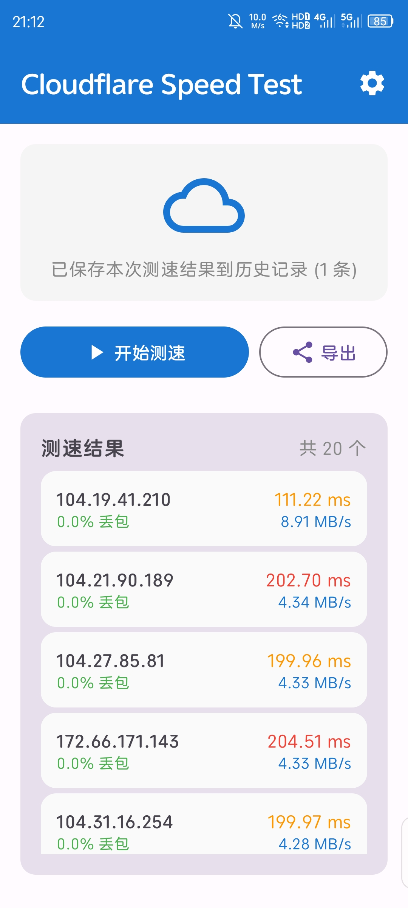
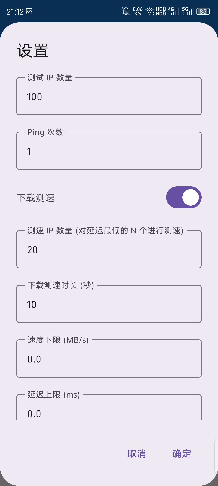
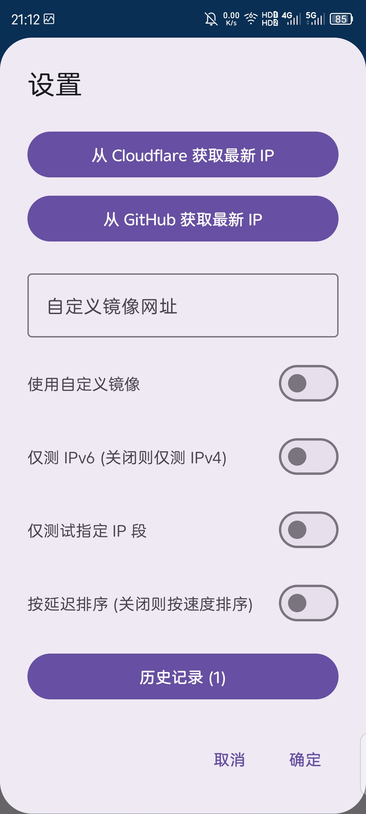

# Cloudflare Speed Test Android App

这是一个用于测试 Cloudflare CDN IP 速度的 Android 应用程序，移植自 [XIU2/CloudflareSpeedTest](https://github.com/XIU2/CloudflareSpeedTest) 项目。

本项目完全由 AI 协助完成：初始开发阶段使用的模型包括 GLM5、Qwen3-Code-Plus、Kimi-K2.5、DeepSeek-V3.2 等；修改优化阶段使用的模型包括 Gemini3.1Pro、Gemini3Pro、GPT4o、GPT5.4 等；**最新 v1.1.0 重构与功能迭代由 Pi Agent 配合 Gemini 3.8 Flash 完成**；图标由豆包生成。

项目继承原版使用 GNU 开源协议。

> [!WARNING]
> 启用下载测速时，尤其在移动数据网络下，可能消耗较大流量。
> 默认参数下，高速 4G/5G 网络单次测速可能消耗数百 MB，极端情况下可接近或超过 1 GB。

## 注意事项

1. 测速时请关闭 VPN/代理，否则结果不准确
2. 下载测速可能消耗较大流量，尤其是在移动数据网络下
3. 流量消耗与“下载测速时长”“下载测速 IP 数量”“当前网络实际速度”直接相关
4. 如使用手机流量，建议关闭下载测速，或显著降低测速 IP 数量与测速时长
5. 首次测速可能延迟偏高，建议多次测速

## 功能特性

- **TCP 延迟测试**: 通过 TCP 连接测试 IP 的延迟和丢包率
- **下载速度测试**: 可选的单连接 128KB 高吞吐下载速度测试
- **Colo 数据中心识别**: 自动识别 Cloudflare 机房地区代码（如 HKG、SJC、NRT 等）并展示在结果列表及 CSV 中
- **目标域名/专属通道穿透校验**: 支持输入加速域名，若填写 WebSocket 路径可直接对源站/节点做全链路握手保真探测，彻底过滤假通死节点
- **即时双向排序**: 在主界面直接一键无缝切换“延迟优先”或“速度优先”
- **全量配置持久化**: 用户调节的测速参数、域名、并发数等永久自动记忆，支持一键恢复默认推荐设置
- **自适应高刷 UI**: 结果列表弹性自适应撑满屏幕，支持单击一键复制 IP 与一键复制最佳 IP
- **手风琴历史记录**: 历史记录支持原地折叠/展开查看完整测速批次结果，告别弹窗套娃
- **CSV 导出**: 支持将测试结果及机房代码导出为标准 CSV 格式
- **官方 IP 更新与定向测速**: 支持直接从 Cloudflare 官方拉取最新 IPv4/IPv6 网段，支持定向多选指定网段测速

## 更新记录

### v1.1.0 - 2026-10-19 (最新版本)
本次更新为架构与功能重大升级，全面解决实际加速中选出“假通死 IP”的痛点，并完成信息架构重构：
- **新增目标域名 / 专属通道 (WS) 全链路穿透校验**：
  - 针对部分 Anycast 节点（如部分亚太网段）仅 TCP 通但无法用于代理加速的核心痛点，新增统一探测引擎；
  - 模拟真实客户端发起带 SNI 的 HTTPS / WebSocket Upgrade 握手，捕获金标协议指纹，秒杀假通死 IP；
  - 动态根据是否输入路径，自动在“Web 网页连通性模式”与“专属通道穿透模式”间平滑切换，并在界面动态回显；
- **新增 Cloudflare 机房地区代码 (Colo) 自动识别**：
  - 测速全链路并发拉取数据中心三字码（如 HKG、SJC 等），在结果卡片、历史记录及 CSV 导出中直观展示；
- **信息架构与 UI 交互现代化重构**：
  - 结果列表解除 300dp 硬编码高度，改为弹性自适应铺满手机剩余屏幕；
  - 结果区上方新增即时排序切换（延迟优先 ⇄ 速度优先）与导出工具条；
  - 主控栏新增「复制最佳 IP」与「清空结果」快捷动作；
  - 顶部栏直观展示当前 IPv4/IPv6 协议徽标，并将历史记录提拔为一级动作入口；
  - 历史记录中心改用手风琴折叠展开，彻底消灭多层弹窗套娃；
  - 设置面板重构为三张高内聚卡片（Ping 探测参数、下载策略与阈值、IP 池与网络管理）；
- **全量用户配置持久化与一键恢复默认**：
  - 用户改动的全部 14 项设置参数自动持久化保存，应用冷启动全量恢复，不再重置；
  - 设置面板顶部增设「恢复默认」按钮，支持一键将所有参数秒级重置为官方推荐默认值；
- **状态卡片两行物理定高防抖动**：
  - 彻底解耦状态说明与目标 IP，给文本区域施加物理定高约束，终结长文本与超长 IPv6 折行引发的高频卡片抽搐。

### v1.0.1 - 2026-05-01
- 新增 `Ping 并发数` 设置项，支持在设置页面中手动调整并发值
- 保留多线程 Ping 筛选能力，以提升整体测试速度
- 将默认 `Ping 次数` 调整为 `3`，默认 `Ping 并发数` 调整为 `8`

## 关键优化与技术细节

### 1. 为什么安卓端测速比电脑端慢？
- **Root 权限问题**: 安卓设备通常没有 Root 权限，无法直接访问底层原始网络栈。
- **系统 I/O 限制**: 安卓系统的 I/O 缓冲区较小，默认配置可能限制了网络吞吐量。
- **硬件性能差异**: 移动设备的 CPU 和网络天线性能通常低于 PC。

### 2. IPv6 测试优化与黑洞防范
- 对于 IPv6（如 /32, /48），其地址池极其庞大。CDN 不可能在每个随机叶子节点上监听服务，若在全区间随机容易命中无人监听的黑洞 IP。
- 本项目锁定前置网络段位，并严格只随机最后 16 位主机号（0x0000 ~ 0xFFFF），完美跳过黑洞节点。

### 3. 为什么之前会测出 0.00 MB/s 或限速 1MB/s？
- **SNI 阻断解决**：下载测速使用官方 `speed.cloudflare.com`，降级使用 HTTP 协议避免握手期 SNI 阻断；
- **智能续航循环架构**：针对千兆 5G 网络瞬间跑完 50MB 的情况，系统会在设定的测试周期（默认 10 秒）内持续循环拉取字节流计算平均速率；
- **128KB 大吞吐缓冲**：字节流读取分配了 128KB 缓冲区，极大减轻 Android 读盘和 GC 负担，跑满真实下行带宽。

## 截图展示

以下是应用的界面截图（待您替换最新截图）：

<p>
  
  
  
</p>

---

## 项目结构

```
CFSTAPP/
├── app/                              # 应用主模块
│   ├── build.gradle                  # 应用级构建配置
│   ├── src/main/
│   │   ├── AndroidManifest.xml       # 清单文件
│   │   ├── java/com/cfst/app/
│   │   │   ├── MainActivity.kt       # Jetpack Compose UI 界面
│   │   │   ├── model/                # 数据模型 (SpeedTestResult)
│   │   │   ├── speedtest/            # 测速核心 (Ping / Download / Colo / 统一探针)
│   │   │   ├── utils/                # CIDR 解析与 IP 采样工具
│   │   │   └── viewmodel/            # 状态流与持久化管理 ViewModel
│   │   └── res/                      # 矢量图标与网络安全配置
├── build.gradle                      # 根构建配置
├── build-apk.bat                     # Windows 一键编译脚本
└── settings.gradle                   # 阿里云 Maven 镜像加速配置
```

## 使用方法

### 方法一：使用 Android Studio（推荐）
1. 打开 Android Studio，选择 **Open**，选中 `CFSTAPP` 根目录；
2. 等待 Gradle 同步完成（已内置国内腾讯云 Gradle 镜像与阿里云 Maven 镜像）；
3. 点击顶部工具栏绿色播放按钮直接运行至连接的真机或模拟器；
4. 或点击菜单 `Build -> Build Bundle(s) / APK(s) -> Build APK(s)`，生成的 APK 位于：
   ```text
   app/build/outputs/apk/debug/app-debug.apk
   ```

### 方法二：一键构建（Windows）
双击运行根目录下的 `build-apk.bat` 脚本，会自动检测环境并编译 APK。

### 设置与使用技巧

- **基础测速**：打开应用直接点击「开始测速」，测完后点击任意卡片即可秒复制 IP，或点击「复制最佳」一键复制第一名；
- **目标域名/专属通道穿透校验**：
  1. 点击右上角「设置」图标，翻到第三张卡片【IP 地址池与网络管理】；
  2. 打开「目标域名/节点连通性校验」；
  3. 填入您的「目标域名 / SNI」；
  4. 若用于代理节点，填入您的「专属通道路径」（例如：`/api/v1/stream`）；
  5. 此时底部会显示紫色的“⚡ 专属通道穿透校验”指示，测速将自动过滤掉无法连接您后端服务的无效节点；
- **恢复默认设置**：若调乱了参数，只需在设置面板点击右上角「恢复默认」，所有配置瞬间整齐归位。

## 致谢

本项目移植自 [XIU2/CloudflareSpeedTest](https://github.com/XIU2/CloudflareSpeedTest)，感谢原作者的优秀工作。
